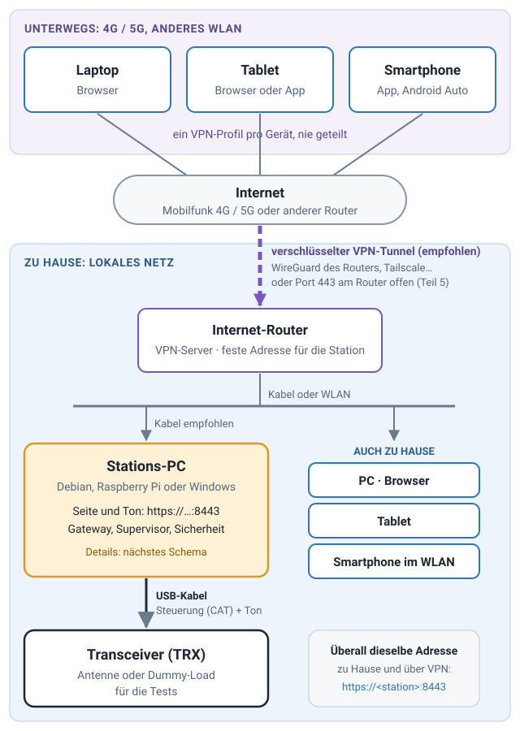
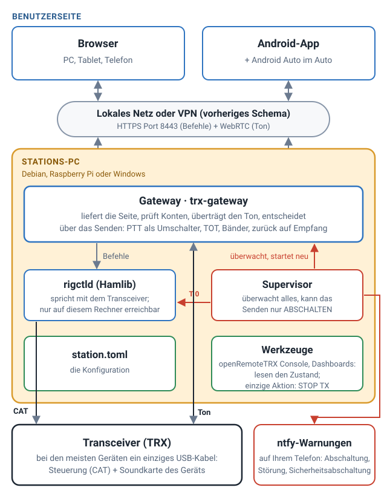

# 0. Bevor Sie beginnen

## Was Sie erhalten

- Ihren Transceiver, gesteuert über einen **Browser** (PC, Tablet, Telefon) oder die **Android-App**: Frequenz,
  Betriebsart, Filter, S-Meter, Empfangston und **Senden in Telefonie** mit dem Mikrofon des Telefons oder des PCs.
- Eine Station, die **sich selbst schützt**: Sie startet immer auf Empfang, schaltet das Senden nach einer
  Höchstdauer ab (standardmäßig 90 s), wenn das Telefon nicht mehr antwortet oder die Verbindung abbricht, und
  verweigert das Senden außerhalb der Bänder, die Sie angegeben haben.
- Einen unabhängigen **Supervisor**, der die Station überwacht und Ihnen Alarme auf Ihr Telefon schicken kann.

## So ist es aufgebaut

- Sie verwenden einen **Browser** oder die **Android-App**. Sie sprechen mit dem **Gateway**, dem Herz der Station,
  das auf dem **Stations-PC** neben dem Transceiver läuft.
- Das Gateway steuert den Transceiver über **rigctld** (das Programm von Hamlib) und tauscht den Ton mit der
  **Soundkarte des Transceivers** aus. Es entscheidet über das Senden und wendet die Sicherheitsfunktionen an.
- Der **Supervisor** überwacht das Ganze unabhängig: Er kann nur eine Sendung abschalten, einen Dienst neu starten und
  Ihnen **Alarme** schicken.
- **openRemoteTRX Console**, das Dashboard und die Anzeige sind Ihre Werkzeuge auf dem PC: Sie lesen den Zustand der
  Station.
- Die Konfiguration steht in einer einzigen Datei, **`station.toml`**.

Jedes Wort wird im [Glossar](glossaire.md) erklärt.

## Die Hardware

| Element | Was Sie brauchen |
|---|---|
| Der Transceiver | ein Transceiver, den Hamlib kennt, sein Netzteil, eine Antenne. Bereits getestete Geräte haben ihr Datenblatt: [Icom IC-7300MK2](postes/ic7300mk2.md) (validiert), [Yaesu FTDX10](postes/ftdx10.md) (Validierung läuft) |
| Die Verbindung PC - Transceiver | bei den meisten neueren Geräten **ein USB-Kabel**, das zugleich die Steuerung (CAT) und den Ton überträgt; sonst ein externes Interface (Digirig, SignaLink…) |
| Der Stations-PC | PC mit **Debian 12 oder 13** mit Desktop (empfohlen), **Raspberry Pi 4 oder 5** mit Raspberry Pi OS 64 Bit oder PC mit **Windows 10/11** 64 Bit. Er bleibt dauerhaft eingeschaltet in der Nähe des Transceivers |
| Das Netzwerk | der PC am Router, am besten **per Kabel** |
| Für die Tests | eine **Dummy-Load** (50 Ω), die die Testleistung verträgt: **Pflicht** für den ganzen Teil 3 |
| Auf Benutzerseite | ein Telefon mit Android 10 oder neuer, oder ein beliebiger aktueller Browser |

## Debian, Raspberry Pi oder Windows?

| | Debian (empfohlen) | Raspberry Pi | Windows |
|---|---|---|---|
| Hardware | ein PC, auch ein alter (2 Kerne, 4 GB) | Pi 4 (**4 GB** empfohlen) oder Pi 5, offizielles Netzteil, Kühlung, am besten eine SSD | ein 64-Bit-PC |
| System | Debian 12 oder 13 | Raspberry Pi OS 64 Bit (Debian 12 oder 13), mit oder ohne Desktop | Windows 10 oder 11 |
| Paket | `trx-remote-debian-X.Y.Z.zip` | das **gleiche** wie Debian | `trx-remote-windows-X.Y.Z.zip` |
| Start | beim Hochfahren des PCs, ohne Anmeldung | beim Hochfahren des Pi, ohne Anmeldung | bei der **Anmeldung Ihrer Sitzung** (der PC muss mit Ihrer geöffneten Sitzung laufen, gesperrt, wenn Sie wollen) |
| Aktualisierungen | über das Internet aus openRemoteTRX Console, Signatur geprüft | wie Debian | von Hand, indem Sie das Installationsprogramm einer neuen Version starten |
| Werkzeuge | openRemoteTRX Console (Menüs 1 bis 8) | dieselbe, auf dem Desktop des Pi oder per SSH von einem anderen PC | openRemoteTRX Console ebenfalls, über die einzige Verknüpfung Startmenü > openRemoteTRX (außer den Aktualisierungen, Menüs 7.x) |
| Stand | validiert (IC-7300MK2) | bei einem Betatester in Betrieb; Last (SDR, FreeDV, mehrere Besucher) noch nicht gemessen | validiert (IC-7300MK2) |

Der Raspberry Pi 3 und ältere Modelle sind für Ton in Echtzeit zu langsam: Die Installation weist darauf hin.

## Vorschriften

> **Sicherheit und Verantwortung.** Sie bleiben für jede Sendung Ihrer Station verantwortlich, **auch aus der
> Ferne**: Einhaltung Ihrer Lizenz, der erlaubten Bänder und Leistungen, Identifikation. Die Bedingungen für den
> Fernbetrieb hängen vom Land ab: Erkundigen Sie sich bei Ihrer Behörde (in Frankreich: die ANFR), bevor
> Sie ihn nutzen. Manche Band-Schaltflächen der Seite (85, 45, 11 m) dienen nur dem **Hören**: Das sind keine
> Amateurfunkbänder.

## Wo Sie die Software finden

Die Installationspakete stehen auf der Versionsseite des Projekts:
https://github.com/Bob56fr/openRemoteTRX/releases

- Debian und Raspberry Pi: `trx-remote-debian-X.Y.Z.zip` (und seine Signaturdatei `.sig`).
- Windows: `trx-remote-windows-X.Y.Z.zip`.

Die Android-App ist im **Test auf Einladung** (Google Play): Beantragen Sie den Zugang, indem Sie ein Ticket öffnen
(Teil 8). Ohne sie erledigt die Webseite alles im Browser des Telefons.
