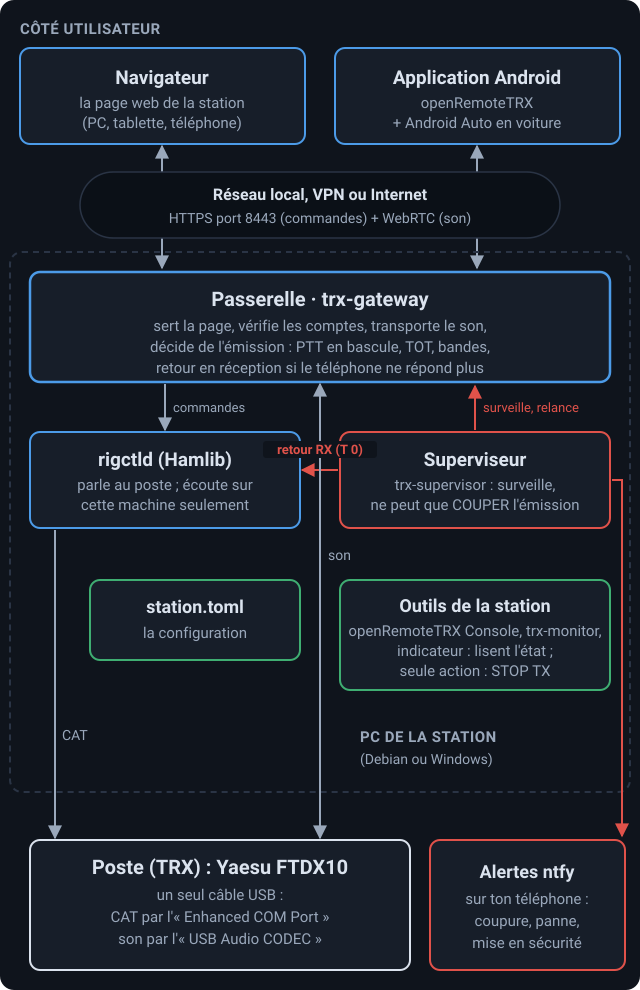

# 0. Before you start

## What you will get

- Your transceiver controlled from a **browser** (PC, tablet, phone) or the **Android app**: frequency, mode,
  filters, S-meter, received audio, and **voice transmission** with the phone's or the PC's microphone.
- A station that **protects itself**: it always starts in receive, cuts the transmission after a maximum duration
  (90 s by default), if the phone stops answering or if the link drops, and refuses to transmit outside the bands
  you have declared.
- An independent **supervisor** that watches the station and can send you alerts on your phone.

## How it is organised

- You use a **browser** or the **Android app**. They talk to the **gateway**, the heart of the station, which runs on
  the **station PC** next to the transceiver.
- The gateway controls the transceiver through **rigctld** (the Hamlib program) and exchanges audio with the
  **transceiver's sound card**. It is the gateway that decides on transmission and applies the safety rules.
- The **supervisor** watches everything independently: it can only cut a transmission, restart a service, and send
  you **alerts**.
- **openRemoteTRX Console**, the dashboard and the indicator are your tools on the PC: they read the station's status.
- The configuration fits in a single file, **`station.toml`**.

Each word is explained in the [glossary](glossaire.md).

## The hardware

| Item | What you need |
|---|---|
| The transceiver | a transceiver known to Hamlib, its power supply, an antenna. Transceivers already tested have their sheet: [Icom IC-7300MK2](postes/ic7300mk2.md) (validated), [Yaesu FTDX10](postes/ftdx10.md) (validation in progress) |
| The PC - transceiver link | on most recent transceivers, **one USB cable** that carries both control (CAT) and audio; otherwise an external interface (Digirig, SignaLink…) |
| The station PC | PC running **Debian 12 or 13** with a desktop (recommended), **Raspberry Pi 4 or 5** running Raspberry Pi OS 64-bit, or a **Windows 10/11** 64-bit PC. It stays on all the time near the transceiver |
| The network | the PC connected to the internet box, preferably **by cable** |
| For the tests | a **dummy load** (50 Ω) that handles the test power: **mandatory** for the whole of part 3 |
| User side | an Android 10 or later phone, or any recent browser |

## Debian, Raspberry Pi or Windows?

| | Debian (recommended) | Raspberry Pi | Windows |
|---|---|---|---|
| Hardware | a PC, even an old one (2 cores, 4 GB) | Pi 4 (**4 GB** advised) or Pi 5, official power supply, cooling, preferably an SSD | a 64-bit PC |
| System | Debian 12 or 13 | Raspberry Pi OS 64-bit (Debian 12 or 13), with or without a desktop | Windows 10 or 11 |
| Package | `trx-remote-debian-X.Y.Z.zip` | the **same** as Debian | `trx-remote-windows-X.Y.Z.zip` |
| Start | when the PC boots, without logging in | when the Pi boots, without logging in | when **you log in** (the PC must stay with your session open, locked if you wish) |
| Updates | over the Internet from openRemoteTRX Console, signature checked | as Debian | by hand, by running the installer of a new version |
| Tools | openRemoteTRX Console (menus 1 to 8) | the same, on the Pi's desktop or over SSH from another PC | openRemoteTRX Console too, through the single shortcut Start menu > openRemoteTRX (except updates, menus 7.x) |
| Status | validated (IC-7300MK2) | in service with a beta tester; load (SDR, FreeDV, several visitors) not measured yet | validated (IC-7300MK2) |

The Raspberry Pi 3 and older models are too slow for live audio: the installation reports it.

## Regulations

> **Safety and responsibility.** You remain responsible for every transmission of your station, **including
> remotely**: compliance with your licence, the allowed bands and powers, identification. The conditions for remote
> operation depend on the country: check with your administration (in France: the ANFR) before using it.
> Some band buttons of the page (85, 45, 11 m) are for **listening** only: they are not amateur radio bands.

## Where to find the software

The installation packages are on the project's releases page:
https://github.com/Bob56fr/openRemoteTRX/releases

- Debian and Raspberry Pi: `trx-remote-debian-X.Y.Z.zip` (and its signature file `.sig`).
- Windows: `trx-remote-windows-X.Y.Z.zip`.

The Android app is in **invitation-only testing** (Google Play): ask for access by opening a ticket (part 8).
Without it, the web page does everything from the phone's browser.
