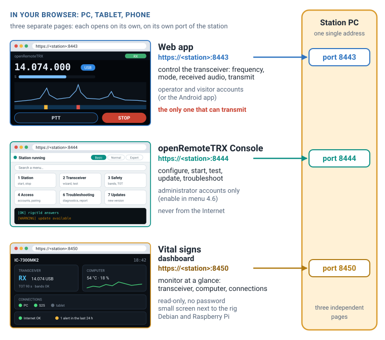

# 4. Using the station on the local network

The local network is your home Wi-Fi or cable: the phone and the station sit behind the same internet box.

Three station pages open in the browser, each one separately, on its own port of the same address:

## 4.1 A fixed address for the station

In your box, **reserve an IP address** for the station PC (DHCP reservation). The certificate created by the wizard
carries the PC's address: if it changes, the browser and the app will no longer recognise it. After an address
change, run the wizard again (menu 2.1) to recreate the certificate.

The address to use is shown at the top of openRemoteTRX Console and by the diagnostic.

## 4.2 The web page

1. On the phone or a PC: `https://<station-address>:8443`
2. The browser reports an **unrecognised certificate**: this is expected (certificate created by your station, not
   by an authority). “Advanced”, then “Proceed”. This is done only once per device.
3. Log in with the account created by the wizard (Enter in the password field is enough).

> **Password remembered by the browser.** Chrome **never** saves a password on a page whose certificate is not
> recognised, even after “Proceed”. The solution: install once, on each device, your **station's authority**
> (below). After that, no more warning and the password is remembered.

### Install the station authority (once per device)

1. On the station, openRemoteTRX Console, menu **4.4** “Station certificate”: choice **1** (recreate the certificate,
   signed by the station authority), then restart the station when the console offers it. The certificate
   fingerprint changes: **pair the Android app again** (menu 4.1).
2. On the device, open the station page: under the password, tap **“Install the station certificate”** (or open
   `https://<station-address>:8443/station-ca.crt`).
3. **Windows**: open the downloaded file, “Install Certificate”, “Current User”, “Place all certificates in the
   following store”, **“Trusted Root Certification Authorities”**, Finish, then accept the Windows warning. Close
   **all** Chrome windows and open it again.
   Careful: with “Automatically select the certificate store”, Windows puts it in “Personal”, where Chrome ignores it
   (address still struck through in red): install it again and choose the right store.
4. **Android**: Settings, Security (or “Security and privacy”), More security settings, Install from device storage
   (or “Encryption and credentials”), **“CA certificate”**, choose the downloaded file and confirm. Open Chrome
   again.
5. Open the page: no more warning; log in, Chrome offers to save the password.

> This authority can vouch **only** for private addresses (local network, VPN) and your station's names: even if its
> key were stolen, it could not impersonate another site (bank…) on your devices.

What you should see: frequency and mode following the transceiver, S-meter, received audio (tap the sound button if
the browser blocked it).

To **transmit**, the page needs the **microphone**: the browser asks for it at the first transmission. It only
offers it over HTTPS, hence the certificate.

> **Safety.** The PTT is a **toggle**: one press to transmit, one press to go back to receive. The state shown is the
> one the station confirms, never a guess. **STOP** cuts at any time. **STOP held for 3 seconds** (large countdown in the
> middle of the screen, releasing cancels) opens a window: “Disconnect”, or “Power off the transceiver remotely” (with a confirmation; only if
> remote power-on is in service, menu 2.8). A hidden page (other tab, locked screen) stops the transmission.
>
> **Transceiver off.** A red “RIG OFF” banner says so. If remote power-on is in service, your connection powers the
> transceiver on by itself: a window shows the steps (serial ports checked, command, start-up, read-back) and, if it
> fails, a clear message with “Retry” and “Continue without the rig”; the “Power on the rig” button of the banner
> does the same. An automatic reconnection never powers the transceiver on. The app does the same (its STOP cuts as
> soon as it is pressed); in the car, Android Auto shows “RIG OFF” or “POWERING ON THE RIG…” as the title.

## 4.3 Several devices, several users

Simple rule: **one account per device**, named after the device (`PC`, `S25`, `tablet`…), even if they are all yours.
The same account opened on a second device **closes the connection of the first** (and cuts its transmission if it
was transmitting). With one account per device, the station knows which one is transmitting, and you can remove a
single device (lost phone) without touching the others.

Everything is done in menu **4.3 “Operator accounts”** of openRemoteTRX Console:

- **add** an account: username, password (Enter = a strong password is generated, write it down), then the
  **pairing QR code** of this account for the app;
- **change a password** (a forgotten password is replaced: the station does not know it in clear);
- **disable** an account (lost or lent phone), then enable it again;
- **delete** an account.

The station applies the changes within a few seconds, without restarting; the connection of an account that is
disabled, deleted or whose password changed is closed at once. The last active operator account can be neither
disabled nor deleted. Only one person can transmit at a time. For listeners without any control, prefer **visitors**
(menu 4.2, part 9).

## 4.4 The Android app

The app (“openRemoteTRX”, Android 10 or later) brings what the page cannot do: transmission that continues with the
screen off, headset button, Android Auto, driving mode.

1. Install the app (invitation-only testing, part 0).
2. On the station, menu **4.1**: openRemoteTRX Console shows the address, the accounts, the certificate fingerprint
   and a **QR code** (without password).
3. In the app: “**Scan the station's QR code**”. The address, username and fingerprint are filled in; enter the
   password.
4. Log in: same check as for the page (frequency, received audio), then a transmission test on a dummy load with
   STOP.

The certificate fingerprint protects the link: the app refuses a station whose certificate has changed. After a new
certificate (address change), do the pairing again.

> **Safety.** In the car, the phone's touch PTT is hidden (driving mode): use Android Auto, voice commands or the
> steering-wheel buttons, and obey the highway code.
