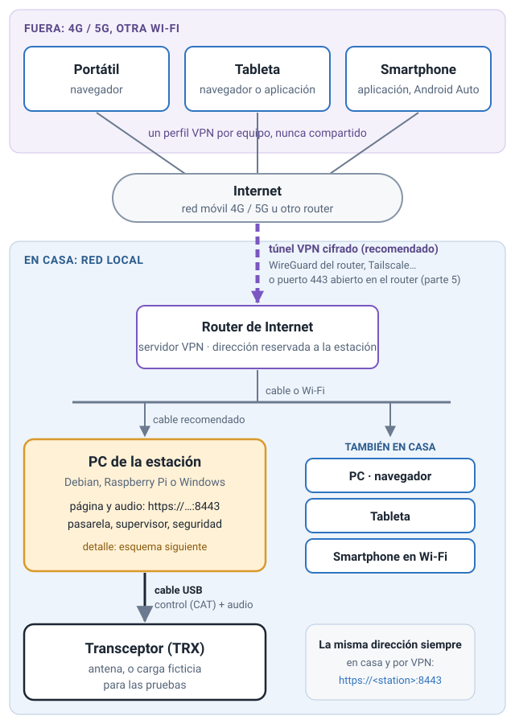
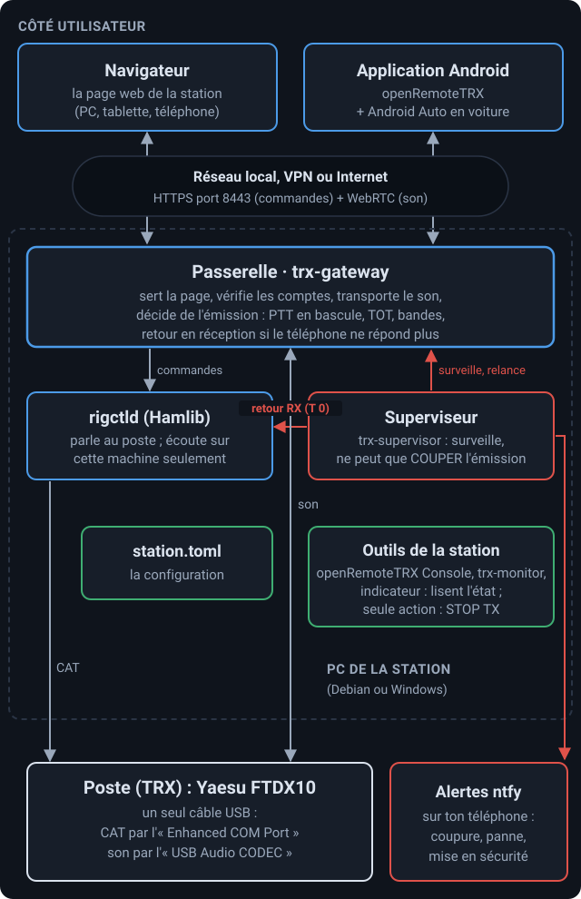

# 0. Antes de empezar

## Lo que vas a obtener

- Tu transceptor controlado desde un **navegador** (PC, tableta, teléfono) o la **aplicación Android**: frecuencia,
  modo, filtros, S-metro, audio recibido, y la **transmisión en fonía** con el micrófono del teléfono o del PC.
- Una estación que **se protege sola**: siempre arranca en recepción, corta la transmisión tras una duración
  máxima (90 s por defecto), si el teléfono deja de responder o si el enlace cae, y se niega a transmitir fuera de las
  bandas que has declarado.
- Un **supervisor** independiente que vigila la estación y puede enviarte alertas al teléfono.

## Cómo está organizado

- Usas un **navegador** o la **aplicación Android**. Hablan con la **pasarela**, el corazón de la estación,
  que funciona en el **PC de la estación** junto al transceptor.
- La pasarela controla el transceptor mediante **rigctld** (el programa de Hamlib) e intercambia el audio con la **tarjeta de sonido del
  transceptor**. Es ella la que decide la transmisión y aplica las seguridades.
- El **supervisor** lo vigila todo de forma independiente: solo puede cortar una transmisión, reiniciar un
  servicio y enviarte **alertas**.
- **openRemoteTRX Console**, el panel y el indicador son tus herramientas en el PC: leen el estado de la estación.
- La configuración cabe en un solo archivo, **`station.toml`**.

Cada palabra se explica en el [glosario](glossaire.md).

## El material

| Elemento | Lo que hace falta |
|---|---|
| El transceptor | un transceptor conocido por Hamlib, su alimentación, una antena. Los transceptores ya probados tienen su ficha: [Icom IC-7300MK2](postes/ic7300mk2.md) (validado), [Yaesu FTDX10](postes/ftdx10.md) (en validación) |
| El enlace PC - transceptor | en la mayoría de los equipos recientes, **un cable USB** que transporta a la vez el control (CAT) y el audio; si no, una interfaz externa (Digirig, SignaLink…) |
| El PC de la estación | PC con **Debian 12 o 13** con escritorio (recomendado), **Raspberry Pi 4 o 5** con Raspberry Pi OS de 64 bits, o PC **Windows 10/11** de 64 bits. Permanece encendido cerca del transceptor |
| La red | el PC conectado al router, preferentemente **por cable** |
| Para las pruebas | una **carga ficticia** (50 Ω) que soporte la potencia de prueba: **obligatoria** para toda la parte 3 |
| Lado del usuario | un teléfono Android 10 o más reciente, o cualquier navegador reciente |

## ¿Debian, Raspberry Pi o Windows?

| | Debian (recomendado) | Raspberry Pi | Windows |
|---|---|---|---|
| Hardware | un PC, aunque sea antiguo (2 núcleos, 4 GB) | Pi 4 (**4 GB** aconsejados) o Pi 5, alimentación oficial, refrigeración, preferentemente un SSD | un PC de 64 bits |
| Sistema | Debian 12 o 13 | Raspberry Pi OS de 64 bits (Debian 12 o 13), con o sin escritorio | Windows 10 u 11 |
| Paquete | `trx-remote-debian-X.Y.Z.zip` | el **mismo** que Debian | `trx-remote-windows-X.Y.Z.zip` |
| Arranque | al arrancar el PC, sin abrir sesión | al arrancar la Pi, sin abrir sesión | al **abrir tu sesión** (el PC debe quedarse con tu sesión abierta, bloqueada si quieres) |
| Actualizaciones | por Internet desde openRemoteTRX Console, firma verificada | como Debian | a mano, volviendo a lanzar el instalador de una nueva versión |
| Herramientas | openRemoteTRX Console (menús 1 a 8) | la misma, en el escritorio de la Pi o por SSH desde otro PC | openRemoteTRX Console también, mediante el único acceso directo menú Inicio > openRemoteTRX (salvo las actualizaciones, menús 7.x) |
| Estado | validado (IC-7300MK2) | en servicio en casa de un probador beta; carga (SDR, FreeDV, varios visitantes) todavía sin medir | validado (IC-7300MK2) |

La Raspberry Pi 3 y los modelos más antiguos son demasiado lentos para el audio en directo: la instalación lo indica.

## Reglamentación

> **Seguridad y responsabilidad.** Sigues siendo responsable de cada transmisión de tu estación, **también a distancia**:
> respeto de tu licencia, de las bandas y potencias permitidas, identificación. Las condiciones del tráfico a
> distancia dependen del país: infórmate ante tu administración (en Francia: la ANFR) antes de usarla.
> Algunos botones de banda de la página (85, 45, 11 m) solo sirven para **escuchar**: no son bandas
> de radioaficionado.

## Dónde encontrar el software

Los paquetes de instalación están en la página de versiones del proyecto:
https://github.com/Bob56fr/openRemoteTRX/releases

- Debian y Raspberry Pi: `trx-remote-debian-X.Y.Z.zip` (y su archivo de firma `.sig`).
- Windows: `trx-remote-windows-X.Y.Z.zip`.

La aplicación Android está en **prueba por invitación** (Google Play): pide el acceso abriendo un ticket (parte 8).
Sin ella, la página web lo hace todo desde el navegador del teléfono.
