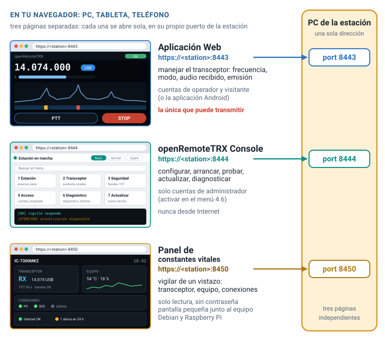

# 4. Usar la estación en la red local

La red local es el Wi-Fi o el cable de casa: el teléfono y la estación están detrás del mismo router.

Tres páginas de la estación se abren en el navegador, cada una por separado, en su propio puerto de la misma dirección:

## 4.1 Una dirección fija para la estación

En tu router, **reserva una dirección IP** para el PC de la estación (reserva DHCP). El certificado creado por el asistente
lleva la dirección del PC: si cambia, el navegador y la aplicación dejarán de reconocerlo. Tras un
cambio de dirección, vuelve a lanzar el asistente (menú 2.1) para rehacer el certificado.

La dirección que usar se muestra en la cabecera de openRemoteTRX Console y en el diagnóstico.

## 4.2 La página web

1. En el teléfono o en un PC: `https://<direccion-de-la-estacion>:8443`
2. El navegador indica un **certificado no reconocido**: es lo esperado (certificado creado por tu estación, no por una
   autoridad). «Avanzado» y luego «Continuar». Solo se hace una vez por dispositivo.
3. Conéctate con la cuenta creada por el asistente (Intro en la contraseña basta).

> **Contraseña recordada por el navegador.** Chrome **nunca** guarda una contraseña en una página cuyo
> certificado no está reconocido, ni siquiera después de «Continuar». La solución: instalar una vez, en cada dispositivo,
> la **autoridad de tu estación** (abajo). Después, ningún aviso más y la contraseña se recuerda.

### Instalar la autoridad de la estación (una vez por dispositivo)

1. En la estación, openRemoteTRX Console, menú **4.4** «Certificado HTTPS de la estación»: opción **1** (rehacer el certificado, firmado
   por la autoridad de la estación), luego reiniciar la estación cuando la consola lo proponga. La huella del certificado
   cambia: **vuelve a emparejar la aplicación Android** (menú 4.1).
2. En el dispositivo, abre la página de la estación: debajo de la contraseña, toca **«Instalar el certificado de la
   estación»** (o abre `https://<direccion-de-la-estacion>:8443/station-ca.crt`).
3. **Windows**: abre el archivo descargado, «Instalar certificado», «Usuario actual», «Colocar todos los
   certificados en el siguiente almacén», **«Entidades de certificación raíz de confianza»**, Finalizar, luego
   acepta el aviso de Windows. Cierra **todas** las ventanas de Chrome y vuelve a abrirlo.
   Atención: con «Seleccionar automáticamente el almacén», Windows lo guarda en «Personal», donde Chrome
   lo ignora (dirección siempre tachada en rojo): repite la instalación eligiendo bien el almacén.
4. **Android**: Ajustes, Seguridad (o «Seguridad y privacidad»), Más ajustes de seguridad,
   Instalar desde el almacenamiento (o «Cifrado y credenciales»), **«Certificado de CA»**, elige el archivo
   descargado y confirma. Vuelve a abrir Chrome.
5. Abre la página: ningún aviso más; conéctate, Chrome propone guardar la contraseña.

> Esta autoridad **solo** puede garantizar direcciones privadas (red local, VPN) y los nombres de tu estación: aunque
> su clave fuera robada, no permitiría imitar otro sitio (banco…) en tus dispositivos.

Lo que debes ver: frecuencia y modo que siguen al transceptor, S-metro, audio recibido (toca el botón del sonido si el
navegador lo ha bloqueado).

Para **transmitir**, la página necesita el **micrófono**: el navegador lo pide en la primera transmisión. Solo lo
propone en HTTPS, de ahí el certificado.

> **Seguridad.** El PTT es un **conmutador**: una pulsación para transmitir, una pulsación para volver a recepción. El estado
> mostrado es el que confirma la estación, nunca una suposición. **STOP** corta en cualquier momento. **STOP mantenido
> 3 segundos** (gran cuenta atrás en el centro de la pantalla, soltar cancela) abre una ventana: «Desconectarse», o «Apagar el TRX a
> distancia» (con una confirmación; solo si el encendido a distancia está en servicio, menú 2.8). Una página oculta
> (otra pestaña, pantalla bloqueada) detiene la transmisión.
>
> **Transceptor apagado.** Una banda roja «EQUIPO APAGADO» lo indica. Si el encendido a distancia está en servicio, tu conexión
> vuelve a encender el transceptor por sí sola: una ventana muestra las etapas (puertos serie comprobados, orden, arranque, relectura) y,
> en caso de fallo, un mensaje claro con «Reintentar» y «Continuar sin el equipo»; el botón «Encender el equipo»
> de la banda hace lo mismo. Una reconexión automática nunca vuelve a encender el transceptor. La aplicación hace lo mismo
> (su STOP corta desde la pulsación); en el coche, Android Auto muestra «EQUIPO APAGADO» o «ENCENDIENDO EL EQUIPO…» como título.

## 4.3 Varios dispositivos, varios usuarios

Regla sencilla: **una cuenta por dispositivo**, con el nombre del dispositivo (`PC`, `S25`, `tableta`…), aunque sean
tuyos. Una misma cuenta abierta en un segundo dispositivo **cierra la conexión del primero** (y corta su transmisión si
estaba transmitiendo). Con una cuenta por dispositivo, la estación sabe cuál transmite, y puedes retirar un solo dispositivo (teléfono
perdido) sin tocar los demás.

Todo se hace en el menú **4.3 «Cuentas de operador»** de openRemoteTRX Console:

- **añadir** una cuenta: usuario, contraseña (Intro = se genera una contraseña robusta, anótala), luego el
  **código QR de emparejamiento** de esta cuenta para la aplicación;
- **cambiar una contraseña** (una contraseña olvidada se sustituye: la estación no la conoce en claro);
- **desactivar** una cuenta (teléfono perdido o prestado), y luego reactivarla;
- **eliminar** una cuenta.

La estación aplica los cambios en unos segundos, sin reiniciar; la conexión de una cuenta desactivada,
eliminada o cuya contraseña ha cambiado se cierra de inmediato. La última cuenta de operador activa no se puede
desactivar ni eliminar. Solo una persona puede transmitir a la vez. Para oyentes sin ninguna orden, prefiere
los **visitantes** (menú 4.2, parte 9).

## 4.4 La aplicación Android

La aplicación («openRemoteTRX», Android 10 o más reciente) aporta lo que la página no puede hacer: transmisión
que continúa con la pantalla apagada, botón de unos auriculares, Android Auto, modo conducción.

1. Instala la aplicación (prueba por invitación, parte 0).
2. En la estación, menú **4.1**: openRemoteTRX Console muestra la dirección, las cuentas, la huella del certificado y un
   **código QR** (sin contraseña).
3. En la aplicación: «**Escanear el código QR de la estación**». La dirección, el usuario y la huella se
   rellenan; introduce la contraseña.
4. Conéctate: misma comprobación que para la página (frecuencia, audio recibido), luego una prueba de transmisión con carga
   ficticia y STOP.

La huella del certificado protege el enlace: la aplicación rechaza una estación cuyo certificado ha cambiado.
Tras un nuevo certificado (cambio de dirección), repite el emparejamiento.

> **Seguridad.** En el coche, el PTT táctil del teléfono está oculto (modo conducción): usa Android Auto, el
> mando por voz o los botones del volante, y respeta el código de circulación.
