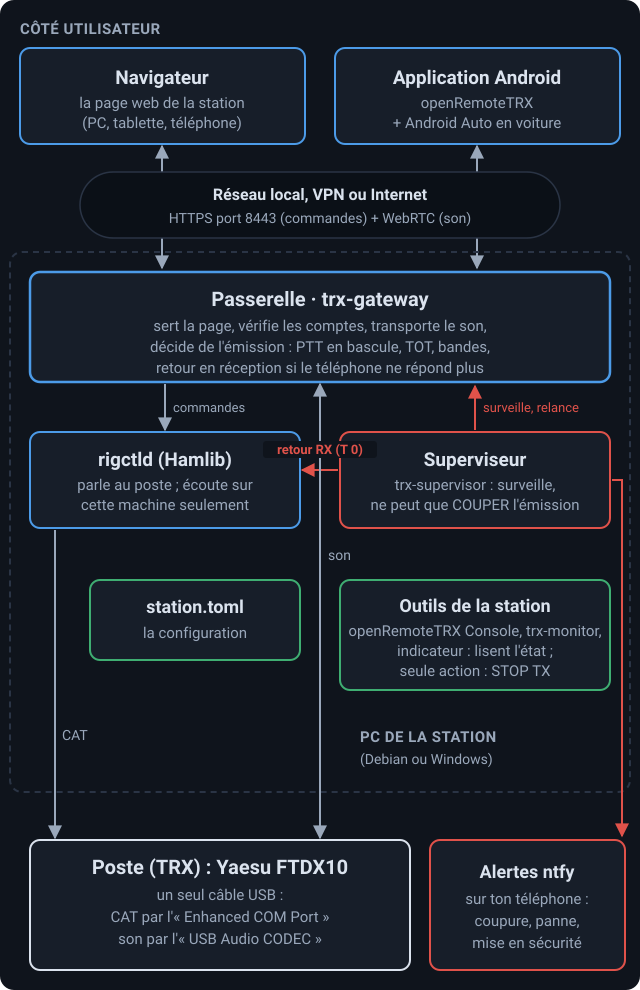

# 0. Avant de commencer

## Ce que tu vas obtenir

- Ton FTDX10 piloté depuis un **navigateur** (PC, tablette, téléphone) ou l'**application Android** : fréquence,
  mode, filtres, S-mètre, son reçu, et l'**émission en phonie** avec le micro du téléphone ou du PC.
- Une station qui **se protège seule** : elle démarre toujours en réception, coupe l'émission au bout d'une durée
  maximale (90 s par défaut), si le téléphone ne répond plus ou si la liaison tombe, et refuse d'émettre hors des
  bandes que tu as déclarées.
- Un **superviseur** indépendant qui surveille la station et peut t'envoyer des alertes sur ton téléphone.

## Comment c'est organisé

- Tu utilises un **navigateur** ou l'**application Android**. Ils parlent à la **passerelle**, le cœur de la station,
  qui tourne sur le **PC de la station** à côté du poste.
- La passerelle commande le poste par **rigctld** (le programme de Hamlib) et échange le son avec la **carte son du
  poste**. C'est elle qui décide de l'émission et applique les sécurités.
- Le **superviseur** surveille le tout de façon indépendante : il ne peut que couper une émission, relancer un
  service, et t'envoyer des **alertes**.
- **TRX Console**, le tableau de bord et l'indicateur sont tes outils sur le PC : ils lisent l'état de la station.
- La configuration tient dans un seul fichier, **`station.toml`**.

Chaque mot est expliqué dans le [glossaire](glossaire.md).

## Le matériel

| Élément | Pour le FTDX10 |
|---|---|
| Le poste | Yaesu FTDX10, alimentation 13,8 V adaptée, antenne |
| La liaison PC - poste | **un câble USB A-B** (prise USB à l'arrière du poste) : il transporte à la fois la commande (CAT) et le son ; aucune interface externe |
| Le PC de la station | PC sous **Debian 12 ou 13** avec bureau (recommandé), ou **Windows 10/11** 64 bits. Il reste allumé en permanence près du poste |
| Le réseau | le PC relié à la box, de préférence **par câble** |
| Pour les essais | une **charge fictive** (50 Ω) qui supporte la puissance d'essai : **obligatoire** pour toute la partie 3 |
| Côté utilisateur | un téléphone Android 10 ou plus récent, ou n'importe quel navigateur récent |

Le Raspberry Pi 4 est prévu mais n'a **jamais été essayé** : ne le choisis pas pour une première station.

## Debian ou Windows ?

| | Debian (recommandé) | Windows |
|---|---|---|
| Démarrage | au démarrage du PC, sans ouvrir de session | à l'**ouverture de ta session** (le PC doit rester avec ta session ouverte, verrouillée si tu veux) |
| Mises à jour | par Internet depuis TRX Console, signature vérifiée | à la main, en relançant l'installateur d'une nouvelle version |
| Outils | TRX Console (menus 1 à 8) | TRX Console aussi, par l'unique raccourci menu Démarrer > TRX distant (sauf les mises à jour, menus 7.x) |

## Réglementation

> **Sécurité et responsabilité.** Tu restes responsable de chaque émission de ta station, **y compris à distance** :
> respect de ta licence, des bandes et des puissances autorisées, identification. Les conditions du trafic à
> distance dépendent du pays : renseigne-toi auprès de ton administration (en France : l'ANFR) avant de l'utiliser.
> Certains boutons de bande de la page (85, 45, 11 m) ne servent qu'à **l'écoute** : ce ne sont pas des bandes
> radioamateur.

## Où trouver le logiciel

Les paquets d'installation sont sur la page des versions du projet :
https://github.com/Bob56fr/openRemoteTRX/releases

- Debian : `trx-remote-debian-X.Y.Z.zip` (et son fichier de signature `.sig`).
- Windows : `trx-remote-windows-X.Y.Z.zip`.

L'application Android est en **test sur invitation** (Google Play) : demande l'accès en ouvrant un ticket (partie 8).
Sans elle, la page web fait tout depuis le navigateur du téléphone.
