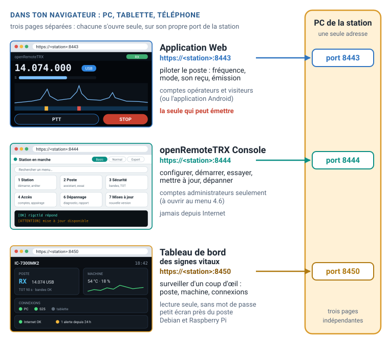

# 4. Utiliser la station sur le réseau local

Le réseau local, c'est le Wi-Fi ou le câble de la maison : le téléphone et la station sont derrière la même box.

Trois pages de la station s'ouvrent dans le navigateur, chacune à part, sur son propre port de la même adresse :

## 4.1 Une adresse fixe pour la station

Dans ta box, **réserve une adresse IP** au PC de la station (réservation DHCP). Le certificat créé par l'assistant
porte l'adresse du PC : si elle change, le navigateur et l'application ne le reconnaîtront plus. Après un
changement d'adresse, relance l'assistant (menu 2.1) pour refaire le certificat.

L'adresse à utiliser est affichée en tête d'openRemoteTRX Console et par le diagnostic.

## 4.2 La page web

1. Sur le téléphone ou un PC : `https://<adresse-de-la-station>:8443`
2. Le navigateur signale un **certificat non reconnu** : c'est attendu (certificat créé par ta station, pas par une
   autorité). « Avancé » puis « Continuer ». Cela ne se fait qu'une fois par appareil.
3. Connecte-toi avec le compte créé par l'assistant (Entrée dans le mot de passe suffit).

> **Mot de passe retenu par le navigateur.** Chrome n'enregistre **jamais** un mot de passe sur une page dont le
> certificat n'est pas reconnu, même après « Continuer ». La solution : installer une fois, sur chaque appareil,
> l'**autorité de ta station** (ci-dessous). Ensuite, plus d'avertissement et le mot de passe est retenu.

### Installer l'autorité de la station (une fois par appareil)

1. Sur la station, openRemoteTRX Console, menu **4.4** « Certificat HTTPS de la station » : choix **1** (refaire le certificat, signé
   par l'autorité de la station), puis redémarrer la station quand la console le propose. L'empreinte du certificat
   change : **appaire de nouveau l'application Android** (menu 4.1).
2. Sur l'appareil, ouvre la page de la station : sous le mot de passe, touche **« Installer le certificat de la
   station »** (ou ouvre `https://<adresse-de-la-station>:8443/station-ca.crt`).
3. **Windows** : ouvre le fichier téléchargé, « Installer un certificat », « Utilisateur actuel », « Placer tous les
   certificats dans le magasin suivant », **« Autorités de certification racines de confiance »**, Terminer, puis
   accepte l'avertissement de Windows. Ferme **toutes** les fenêtres de Chrome et rouvre-le.
   Attention : avec « Sélectionner automatiquement le magasin », Windows le range dans « Personnel », où Chrome
   l'ignore (adresse toujours barrée de rouge) : refais l'installation en choisissant bien le magasin.
4. **Android** : Paramètres, Sécurité (ou « Sécurité et confidentialité »), Plus de paramètres de sécurité,
   Installer depuis le stockage (ou « Chiffrement et identifiants »), **« Certificat CA »**, choisis le fichier
   téléchargé et confirme. Rouvre Chrome.
5. Ouvre la page : plus d'avertissement ; connecte-toi, Chrome propose d'enregistrer le mot de passe.

> Cette autorité ne peut garantir **que** des adresses privées (réseau local, VPN) et les noms de ta station : même
> si sa clé était volée, elle ne permettrait pas d'imiter un autre site (banque…) sur tes appareils.

Ce que tu dois voir : fréquence et mode qui suivent le poste, S-mètre, son reçu (touche le bouton du son si le
navigateur l'a bloqué).

Pour **émettre**, la page a besoin du **micro** : le navigateur le demande à la première émission. Il ne le
propose qu'en HTTPS, d'où le certificat.

> **Sécurité.** Le PTT est une **bascule** : un appui pour émettre, un appui pour revenir en réception. L'état
> affiché est celui que la station confirme, jamais une supposition. **STOP** coupe à tout moment. **STOP maintenu
> 3 secondes** (grand compte à rebours au milieu de l'écran, relâcher annule) ouvre une fenêtre : « Se déconnecter », ou « Arrêter le TRX à
> distance » (avec une confirmation ; seulement si l'allumage à distance est en service, menu 2.8). Une page masquée
> (autre onglet, écran verrouillé) arrête l'émission.
>
> **Poste éteint.** Un bandeau rouge « POSTE ÉTEINT » le dit. Si l'allumage à distance est en service, ta connexion
> rallume le poste toute seule : une fenêtre montre les étapes (ports série vérifiés, ordre, démarrage, relecture) et,
> en cas d'échec, un message clair avec « Réessayer » et « Continuer sans le poste » ; le bouton « Allumer le poste »
> du bandeau fait la même chose. Une reconnexion automatique ne rallume jamais le poste. L'application fait de même
> (son STOP coupe dès l'appui) ; en voiture, Android Auto affiche « POSTE ÉTEINT » ou « ALLUMAGE DU POSTE… » en titre.

## 4.3 Plusieurs appareils, plusieurs utilisateurs

Règle simple : **un compte par appareil**, nommé d'après l'appareil (`PC`, `S25`, `tablette`…), même s'ils sont à
toi. Un même compte ouvert sur un second appareil **ferme la connexion du premier** (et coupe son émission s'il
émettait). Avec un compte par appareil, la station sait lequel émet, et tu peux retirer un seul appareil (téléphone
perdu) sans toucher aux autres.

Tout se fait au menu **4.3 « Comptes opérateurs »** d'openRemoteTRX Console :

- **ajouter** un compte : identifiant, mot de passe (Entrée = un mot de passe fort est généré, note-le), puis le
  **QR code d'appairage** de ce compte pour l'application ;
- **changer un mot de passe** (un mot de passe oublié se remplace : la station ne le connaît pas en clair) ;
- **désactiver** un compte (téléphone perdu ou prêté), puis le réactiver ;
- **supprimer** un compte.

La station prend les changements en quelques secondes, sans redémarrer ; la connexion d'un compte désactivé,
supprimé ou dont le mot de passe a changé est fermée aussitôt. Le dernier compte opérateur actif ne peut être ni
désactivé ni supprimé. Une seule personne peut émettre à la fois. Pour des auditeurs sans aucune commande, préfère
les **visiteurs** (menu 4.2, partie 9).

## 4.4 L'application Android

L'application (« openRemoteTRX », Android 10 ou plus récent) apporte ce que la page ne peut pas faire : émission
qui continue écran éteint, bouton d'un casque, Android Auto, mode conduite.

1. Installe l'application (test sur invitation, partie 0).
2. Sur la station, menu **4.1** : openRemoteTRX Console affiche l'adresse, les comptes, l'empreinte du certificat et un
   **QR code** (sans mot de passe).
3. Dans l'application : « **Scanner le QR code de la station** ». L'adresse, l'identifiant et l'empreinte se
   remplissent ; saisis le mot de passe.
4. Connecte-toi : même vérification que pour la page (fréquence, son reçu), puis un essai d'émission sur charge
   fictive avec STOP.

L'empreinte du certificat protège la liaison : l'application refuse une station dont le certificat a changé.
Après un nouveau certificat (changement d'adresse), refais l'appairage.

> **Sécurité.** En voiture, le PTT tactile du téléphone est masqué (mode conduite) : utilise Android Auto, la
> commande vocale ou les touches du volant, et respecte le code de la route.
